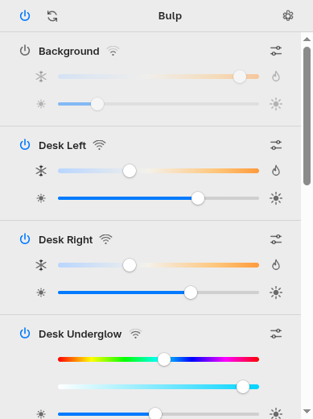
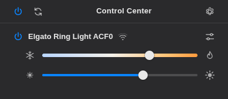

# Bulp

> **AI generated:** this project was written with [Claude Code](https://claude.com/claude-code), Anthropic's
> AI coding assistant, directed by its author and tested against real lights.
> Expect the rough edges of a young project, and please report anything that doesn't work.

Bulp controls Elgato lights (Key Light, Key Light Air/Mini/Neo, Ring Light, Light Strip, …) from the Linux
desktop: a tray icon to switch lights on and off, and a control panel for brightness, color temperature
and color. It talks to the lights directly over your local network; no account, no cloud.
There's also a command-line tool, `bulp`.

<p>
  
  
</p>

Bulp is an unofficial app, not affiliated with or endorsed by Elgato or Corsair. On macOS and Windows, use
Elgato's official Control Center app (the `bulp` CLI works there too).

## Install

Downloads are on the [releases page](https://github.com/Nilpointer/bulps/releases):

| Download | |
|---|---|
| **Flatpak** `de.codecauldron.Bulp.flatpak` | `flatpak install --user de.codecauldron.Bulp.flatpak`, then start Bulp from your app launcher. Pulls the GNOME runtime from Flathub. Includes the CLI: `flatpak run --command=bulp de.codecauldron.Bulp`. |
| **AppImage** `Bulp-<version>-x86_64.AppImage` | `chmod +x` and run. Shows the panel in a native window if GTK 4 + WebKitGTK 6.0 are installed (Ubuntu 24.04+, Debian 12+, current Fedora/Arch), otherwise in your browser. |
| **CLI** `bulp-<os>-<arch>` | Single static binary for Linux and macOS (amd64/arm64). |

### Tray icon on GNOME

KDE, Cinnamon, MATE, Budgie, XFCE, Ubuntu's GNOME and waybar (`tray` module) show the tray icon out of the
box. Stock GNOME (e.g. Fedora Workstation, Arch) has no system tray; install the
[AppIndicator extension](https://extensions.gnome.org/extension/615/appindicator-support/):

```sh
sudo dnf install gnome-shell-extension-appindicator   # same package name on Arch (pacman) and Debian (apt)
# log out and back in, then:
gnome-extensions enable appindicatorsupport@rgcjonas.gmail.com
```

Without a tray, Bulp runs as just the control panel window and quits when you close it.

## Using Bulp

- **Tray icon:** left click opens the control panel; the right-click menu switches each light on or off.
  The icon lights up while any light is on.
- **Control panel:** power, color temperature and brightness per light; hue and saturation for color
  lights such as the Light Strip. The power button at the top switches all lights at once; the sliders
  icon on a light shows its details (model, firmware, serial number, address, Wi-Fi signal) and an
  Identify button that makes the light blink.
- **One instance:** launching Bulp again brings up the panel of the running instance.
- **Finding lights:** lights are found automatically via Bonjour/mDNS, through the Avahi daemon when it's
  running (much more reliable with lights on Wi-Fi). If multicast is blocked on your network, pass the
  addresses: `bulp-menubar -host 192.168.1.20,192.168.1.21`.

## CLI

```sh
bulp list                    # discover lights
bulp status
bulp on | off | toggle
bulp brightness 40           # or +10 / -10
bulp temp 4500               # Kelvin, 2900–7000
bulp color 200 80            # hue, saturation (color lights)
bulp identify | info | settings | rename "Desk"
```

Flags: `-name <substr>` to pick lights, `-host <ip>` (or `BULP_HOST`) to skip discovery, `-json`.

### Scripts and AI agents

The `bulp` CLI is the interface for scripts and AI coding agents (Claude Code, Codex, …): it's
non-interactive, exits with status 0 on success and 1 on errors (message on stderr), and with `-json`
every command prints one array with an entry per light:

```sh
$ bulp -json status
[{"name": "Desk Left", "host": "192.168.1.20:9123", "on": true, "brightness": 40, "kelvin": 3500},
 {"name": "Shelf Strip", "host": "192.168.1.21:9123", "on": true, "brightness": 85, "hue": 265, "saturation": 80}]
```

- **Skip discovery:** `export BULP_HOST=192.168.1.20,192.168.1.21` (addresses from `bulp list`). Commands
  then don't browse the network first, and always hit the same lights.
- **Pick lights by name:** `-name desk` acts only on lights whose name contains "desk", with or without
  `BULP_HOST`.
- **Allow it without prompts:** in Claude Code, add `"Bash(bulp:*)"` to `permissions.allow` in
  `.claude/settings.json` (or `~/.claude/settings.json`).

**Agent skill:** [`skills/bulp/SKILL.md`](skills/bulp/SKILL.md) teaches an agent when and how to use
`bulp` (finding the command, reading the state first, mapping "a bit warmer" to a command, handling
unreachable lights), so it works from any directory. Install it for Claude Code with

```sh
mkdir -p ~/.claude/skills && cp -r skills/bulp ~/.claude/skills/
```

then just ask "dim the lights to 40%". Other agents that support the Agent Skills `SKILL.md` format load
the same folder from their own skills directory.

### Automating lights out

For a fixed schedule, cron is all you need. Use the standalone CLI binary from the releases page (e.g.
installed as `/usr/local/bin/bulp`), set `PATH` (cron's default doesn't include `/usr/local/bin`) and
`BULP_HOST`, so it doesn't depend on network discovery at night. `crontab -e`:

```cron
PATH=/usr/local/bin:/usr/bin:/bin
BULP_HOST=192.168.1.20,192.168.1.21
# Lights off at 23:00 every day, and at 18:30 on weekdays
0 23 * * *    bulp off
30 18 * * 1-5 bulp off
# Dim to 20 % and warm up at 21:00
0 21 * * *    bulp brightness 20 && bulp temp 2900
```

A systemd user timer works the same way (`bulp off` as the service's `ExecStart`) and also catches up
on runs missed while the computer was off (`Persistent=true`).

Reach for an agent only when the rule needs judgment or context a schedule can't express, like "lights
off, but keep the desk light on while I'm still in a video call". Run it headless from cron and allow it
nothing but `bulp` and the checks it needs (the `PATH` and `BULP_HOST` lines from above apply to the
agent's commands too):

```cron
0 23 * * * cd ~ && /home/you/.local/bin/claude -p "Turn off all lights. If Zoom or Teams is running, keep the desk light on." --allowedTools "Bash(bulp:*)" "Bash(pgrep:*)"
```

Whatever runs the schedule has to be on the same network as the lights: cloud-hosted agents and
scheduled cloud tasks can't reach them.

## Build from source

Go is pinned with [mise](https://mise.jdx.dev). The tray app needs cgo and the GTK 4 + WebKitGTK 6.0
development packages: `sudo dnf install gtk4-devel webkitgtk6.0-devel`
(Debian/Ubuntu: `libgtk-4-dev libwebkitgtk-6.0-dev`).

```sh
mise run build         # bin/bulp, bin/bulp-menubar
mise run build-linux   # static binaries in bin/linux-{amd64,arm64}/ (no cgo: the panel opens in a browser)
mise run test
mise run flatpak       # build + install the Flatpak locally, then: flatpak run de.codecauldron.Bulp
mise run flatpak-bundle  # single-file build/de.codecauldron.Bulp.flatpak
mise run appimage      # build/Bulp-<version>-x86_64.AppImage (needs podman or docker)
mise run release       # all of the above release files + CLI binaries + SHA256SUMS in build/release/
```

### Layout

- `elgato/` – library: Bonjour discovery and an HTTP client for the lights' API (port 9123)
- `cmd/bulp` – CLI
- `cmd/bulp-menubar` – tray app; `internal/ui` serves the control panel (HTML/JS) on 127.0.0.1,
  `internal/webview` shows it in a GTK window
- `packaging/` – desktop entry, AppStream metadata, icon, Flatpak manifest, AppImage build

### Packaging notes

The Flatpak (`packaging/flatpak/de.codecauldron.Bulp.yml`) uses the GNOME 51 runtime, which ships GTK 4 and
WebKitGTK; one-time setup: `flatpak install flathub org.flatpak.Builder`.

The AppImage doesn't bundle GTK or WebKit (~17 MB). It carries two builds of `bulp-menubar`: one linked
against the system's GTK 4 + WebKitGTK 6.0 (built in an Ubuntu 24.04 container so it runs on glibc ≥ 2.34)
and a static one that opens the panel in a browser; `AppRun` starts the first if its libraries load.

## License

[MIT](LICENSE)
